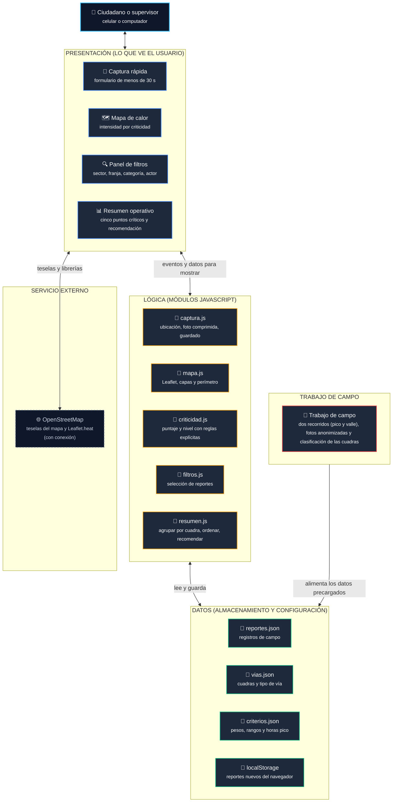

# Santa Marta en orden

Prototipo web ciudadano para registrar y consultar situaciones de mal parqueo e invasión del espacio público en Santa Marta, Colombia.

## Funcionalidades

- **Registro ciudadano:** permite marcar un punto dentro del perímetro de cobertura aproximado o usar la geolocalización, completar automáticamente la dirección, describir la situación y el tipo de actor, y adjuntar una foto opcional.
- **Censura fotográfica:** antes de guardar una foto, se muestra en un canvas de hasta 800 px de ancho. Se pueden marcar rectángulos con mouse o tacto, pixelarlos en bloques de al menos 12 px y deshacer cambios. El envío permanece bloqueado hasta confirmar que no quedan rostros, placas ni otros datos personales; solo se guarda la exportación JPEG confirmada.
- **Dirección del reporte:** la dirección se consulta al marcar el mapa mediante Photon (datos de OpenStreetMap); si no está disponible, se puede escribir manualmente. Las coordenadas se comparten con ese servicio para realizar la consulta.
- **Tarjetas y mapa de infracciones:** una vista dedicada muestra un mapa de calor junto a tarjetas con dirección, cuadra, actor, situación, criticidad, origen, fecha, coordenadas y foto disponible. En móvil, las tarjetas se despliegan debajo del mapa y la página conserva el desplazamiento vertical.
- **Gráficas comparativas:** una vista dedicada compara todas las variables de los reportes (cuadra, categoría, tipo de actor, franja horaria, nivel de criticidad, origen y día de la semana) mediante barras proporcionales, tarjetas con el valor más frecuente y una matriz de categoría × actor. Se actualiza al cargar, guardar o importar reportes y no depende de los filtros del tablero.
- **Validación de ubicación:** conserva el perímetro de cobertura aproximado anterior y añade una extensión ilustrativa hacia el costado de El Cisne, definida en `mapa.js`. El contorno no representa un límite oficial.
- **Almacenamiento local:** los reportes nuevos se guardan en `localStorage` del navegador. No hay servidor ni base de datos central; los datos permanecen en el dispositivo y navegador usados.
- **Mapa y tablero:** presenta los reportes sobre un mapa de calor y permite mostrar u ocultar sus puntos individuales. El mapa base utiliza OpenStreetMap.
- **Filtros y prioridades:** permite filtrar por dirección o sector, franja horaria, situación y tipo de actor. El resumen presenta hasta cinco ubicaciones, ordenadas por puntaje total, con recomendaciones según las reglas definidas. Si la vía no se puede clasificar desde el mapa, no se asignan puntos por tipo de vía.
- **Criticidad:** calcula un puntaje sumando los valores de la categoría, el tipo de vía cuando está identificado y la franja horaria. Si la vía no se puede clasificar desde el mapa, el componente vial aporta cero puntos. Las horas pico, valores y niveles se configuran en `datos/criterios.json`.
- **Importación y exportación:** importa reportes desde un archivo JSON, omite identificadores duplicados y valida los registros nuevos; también permite descargar los reportes actuales.
- **Impresión:** el botón de impresión genera una versión del resumen operativo adecuada para imprimir.
- **Privacidad:** el formulario recomienda no capturar placas, rostros ni otros datos personales. Si se adjunta una foto, se conserva únicamente su versión censurada y confirmada; las fotos y reportes ciudadanos se almacenan localmente.
- **Interfaz accesible:** diseño adaptable a móvil y escritorio, controles etiquetados, mensajes de estado y animaciones de aparición al desplazarse, desactivadas cuando el dispositivo solicita reducir el movimiento.
- **Tema claro y oscuro:** el selector del encabezado alterna la apariencia, guarda la preferencia en el navegador y respeta el tema del sistema en la primera visita. Los mapas mantienen sus colores originales.

## Arquitectura de la solución

Toda la aplicación corre en el navegador del usuario (arquitectura 100% cliente / Jamstack sin backend centralizado). Los registros levantados en campo, la clasificación de las cuadras y los pesos del índice viajan con el proyecto en archivos JSON. Los reportes nuevos se guardan en `localStorage`, que pertenece a cada navegador: por eso el tablero muestra los datos precargados más lo registrado en ese mismo equipo, y la exportación e importación cumple el papel de reunir reportes de varios dispositivos. El mapa base se arma con teselas de OpenStreetMap (que requieren conexión), mientras que el mapa de calor y la lógica analítica se ejecutan localmente con los datos propios.



## Estructura

| Archivo | Propósito |
| --- | --- |
| `index.html` | Interfaz, estilos y animaciones de desplazamiento. |
| `captura.js` | Carga de datos, registro, validación, almacenamiento, importación/exportación, filtros, resumen y estadísticas. |
| `mapa.js` | Mapas Leaflet, selección de ubicación, perímetro aproximado y capas de reportes. |
| `criticidad.js` | Cálculo del puntaje y nivel de criticidad. |
| `filtros.js` | Filtrado de reportes y clasificación horaria. |
| `resumen.js` | Agrupación por cuadra y reglas de recomendación operativa. |
| `datos/reportes.json` | Reportes de ejemplo que se cargan al iniciar. |
| `datos/vias.json` | Cuadras y tipos de vía usados en el puntaje. |
| `datos/criterios.json` | Puntajes, rangos de hora pico y niveles de criticidad. |

## Cómo ejecutarlo

La aplicación es estática y no requiere instalación de dependencias del proyecto. Debe servirse por HTTP para que el navegador pueda cargar los módulos JavaScript y archivos JSON. Desde la carpeta del proyecto, ejecuta:

```powershell
python -m http.server 8000
```

Luego abre <http://localhost:8000>. También se puede utilizar cualquier servidor estático local equivalente.

Leaflet, Leaflet.heat y las teselas de OpenStreetMap se obtienen de servicios externos, por lo que las funciones de mapa requieren conexión a internet. La geolocalización depende del permiso del usuario y de que el navegador la permita en el contexto de ejecución.

## Alcance y limitaciones

Este proyecto es un prototipo educativo, no un sistema oficial de recepción o atención de denuncias. La ubicación se limita mediante un polígono aproximado; los datos de ejemplo y las reglas de criticidad deben verificarse antes de cualquier uso operativo. La información guardada en el navegador no se sincroniza entre dispositivos ni se envía a una entidad.
