# Diagrama de Arquitectura del Sistema · Reto No. 2
**Control de Mal Parqueo e Invasión del Espacio Público en Santa Marta**  
*Universidad del Magdalena · Facultad de Ingeniería · Programa de Ingeniería de Sistemas*

---

## 1. Arquitectura de Referencia (100% Client-Side / Jamstack)

El prototipo opera íntegramente en el navegador web del usuario, sin requerir backend propietario ni base de datos central en la nube. Los datos de configuración inicial viajan en archivos JSON estáticos y las capturas nuevas se almacenan en el `localStorage` del cliente.

```mermaid
flowchart TD
    classDef capaPres fill:#11161D,stroke:#06B6D4,stroke-width:1.5px,color:#F8FAFC;
    classDef capaExt fill:#0B0F14,stroke:#64748B,stroke-width:1.5px,stroke-dasharray: 4 4,color:#94A3B8;
    classDef capaLog fill:#161D26,stroke:#FBBF24,stroke-width:1.5px,color:#F8FAFC;
    classDef capaData fill:#161D26,stroke:#10B981,stroke-width:1.5px,color:#F8FAFC;
    classDef userNode fill:#082F49,stroke:#06B6D4,stroke-width:2px,color:#F8FAFC;

    User["👤 Ciudadano o Supervisor de Movilidad<br><small>Navegador Web (Móvil / Desktop)</small>"]:::userNode

    subgraph PRESENTACION ["PRESENTACIÓN · UI / UX (index.html, styles.css)"]
        direction LR
        UI_Cap["📝 Captura Rápida<br><small>Formulario &lt; 30s con geolocalización</small>"]:::capaPres
        UI_Cen["🛡️ Módulo de Censura<br><small>Canvas pixelado de placas y rostros</small>"]:::capaPres
        UI_Map["🗺️ Mapa de Reincidencia<br><small>Leaflet + Leaflet.heat ponderado</small>"]:::capaPres
        UI_Fil["🔍 Panel de Filtros<br><small>Franja, situación, actor, sector</small>"]:::capaPres
        UI_Res["📊 Historial & Resumen<br><small>Tarjetas Hero-Banner y Top 5</small>"]:::capaPres
    end

    subgraph SERVICIOS_EXTERNOS ["SERVICIOS EXTERNOS (Conexión Requerida)"]
        EXT_OSM["🌐 OpenStreetMap & Photon<br><small>Teselas del mapa y Geocodificación inversa</small>"]:::capaExt
        EXT_CDN["📦 CDN Libraries<br><small>Leaflet 1.9.4, Leaflet.heat, Chart.js</small>"]:::capaExt
    end

    subgraph LOGICA ["LÓGICA DEL SISTEMA (JavaScript ES6+)"]
        direction LR
        JS_Cap["📄 captura.js<br><small>Controlador central, DOM, scroll infinito</small>"]:::capaLog
        JS_Map["📄 mapa.js<br><small>Inicialización Leaflet, capas de calor, centrado</small>"]:::capaLog
        JS_Cri["📄 criticidad.js<br><small>Algoritmo de cálculo de severidad y puntaje</small>"]:::capaLog
        JS_Cua["📄 cuadras.js<br><small>Algoritmo de distancia euclidiana &lt; 30m</small>"]:::capaLog
        JS_Fil["📄 filtros.js<br><small>Filtrado reactivo y franjas horarias</small>"]:::capaLog
        JS_Res["📄 resumen.js<br><small>Agrupación de puntos y reglas de recomendación</small>"]:::capaLog
    end

    subgraph DATOS ["ALMACENAMIENTO Y MODELO DE DATOS"]
        direction LR
        DB_Rep["📁 datos/reportes.json<br><small>Registros de campo precargados</small>"]:::capaData
        DB_Via["📁 datos/vias.json<br><small>Coordenadas de tramos y tipos de vía</small>"]:::capaData
        DB_Cri["📁 datos/criterios.json<br><small>Pesos, horas pico y rangos</small>"]:::capaData
        DB_Fot["📁 datos/fotos/<br><small>Evidencia fotográfica anonimizada</small>"]:::capaData
        DB_Loc["💾 localStorage<br><small>Reportes locales nuevos del dispositivo</small>"]:::capaData
    end

    User <--> PRESENTACION
    PRESENTACION <-->|Renderizado de capas y geocodificación| SERVICIOS_EXTERNOS
    PRESENTACION <-->|Disparo de eventos y manipulación DOM| LOGICA
    LOGICA <-->|Lectura JSON y persistencia local| DATOS
```

---

## 2. Flujo de Datos del Caso de Uso Principal (CU-01: Reportar Obstrucción)

1. **Entrada:** El usuario selecciona la ubicación en el mapa (o geolocalización del dispositivo), selecciona la categoría de infracción y el tipo de actor vial, y adjunta una foto opcional.
2. **Anonimización:** Si hay fotografía, pasa por `captura.js` donde el usuario censura placas y rostros mediante bloques de pixelado sobre un elemento `<canvas>`.
3. **Cálculo de Criticidad (`criticidad.js` y `cuadras.js`):**
   - Se identifica si las coordenadas caen a menos de 30 metros de algún tramo de `vias.json` (Vía Arterial: 3 pts, Vía Secundaria: 1 pt).
   - Se evalúa la hora del incidente contra `criterios.json` (Hora Pico: 3 pts, Hora Valle: 1 pt).
   - Se suma el peso de la categoría (3 o 2 pts).
4. **Salida y Persistencia:** El nuevo reporte se almacena en el `localStorage` del navegador y dispara un evento personalizado `reporte:creado` que actualiza el mapa de calor y el historial sin recargar la página.
